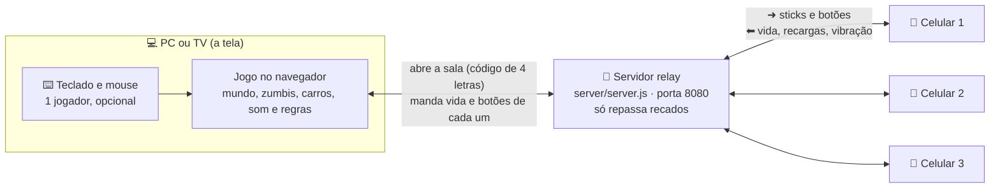

# Como o jogo funciona (sem código)

## A ideia em uma frase
O **PC** (ou a TV) roda o jogo inteiro. Os **celulares** são só controles: mandam para onde o jogador anda e que botão apertou.
Um **servidor pequeno** fica no meio, só passando recados entre a tela e os celulares.

## Quem conversa com quem

O que acontece quando alguém entra:
1. A tela abre o jogo e pede uma **sala** ao servidor. O servidor devolve um código de 4 letras (aparece no menu com o QR code).
2. O celular lê o QR code, abre a página de controle e manda o código. O servidor coloca o celular naquela sala.
3. A tela recebe "entrou alguém" e ocupa uma vaga no menu. Cada um **escolhe a classe** com ◀ ▶ (no celular, no mouse ou com A/D no teclado).
   Pode repetir classe. A cor da vaga aparece como um anel no chão, sob o jogador, para cada um se achar na tela.
4. Durante a partida, cada celular manda os sticks ~30 vezes por segundo. A tela devolve vida, botões e recargas ~7 vezes por segundo.
5. O teclado do PC usa **exatamente o mesmo formato** do celular. Por isso dá para misturar teclado e celulares.

Por que assim: ninguém precisa instalar nada nem ter controle. E, como o jogo só roda na tela, todo mundo vê a mesma coisa.

## O que cada pasta faz

O código está dividido em **3 andares**, como um prédio. Quem está em cima pode usar o que está embaixo, nunca o contrário.
O comando `npm run check` confere essa regra sozinho.

| Andar | Pasta | O que tem | Por que separar |
|---|---|---|---|
| 🏗️ Térreo: o motor | `src/engine/` | O que qualquer jogo precisa: desenhar a tela, dividir a tela, ler teclado e celular, falar com o servidor, tocar som, carregar o mapa em pedaços, colisão | Não sabe que existem zumbis. Os 3 jogos (este, o souls-like e o RPG) usam igual |
| 🧱 1º andar: peças prontas | `src/shared/` | Personagens e animações, o modelo do zumbi, o mundo (estradas, vilas, casas, placas, clima, água), carros, efeitos, a biblioteca de sons | Cada jogo escolhe as peças que quer usar |
| 🎮 2º andar: este jogo | `src/games/survivor/` | As regras do survivor: classes e habilidades, armas, a horda de zumbis, morte e revive, placar | As regras de um jogo não vazam para os outros |

Quando uma peça de baixo precisa que algo aconteça em cima, ela **avisa** em vez de chamar direto.
Exemplo: o mundo avisa "a porta abriu" e o jogo decide qual som tocar. O gerador do mapa avisa "aqui cabe um carro" e o jogo decide se cria o carro.

| Pasta / arquivo | O que faz | Exemplo do que você vê |
|---|---|---|
| `index.html`, `main.css` | A página do jogo e o visual do placar (HUD) | Relógio, pontos e vida no canto |
| `controller.html` | A página do controle no celular | Os dois sticks e os botões |
| `server/` | O servidor que passa recados entre tela e celulares | O código de 4 letras |
| `src/engine/render/` | Desenhar, dividir a tela, luz, cores | A tela que divide quando o grupo se separa |
| `src/engine/input/` | Teclado, mouse e o código que roda no celular | WASD; vibrar quando leva mordida |
| `src/engine/net/` | A conexão da tela com o servidor | "Servidor conectado" no menu |
| `src/engine/world/` | Carregar o mapa em pedaços, colisão, caminho dos inimigos | Zumbi contornando um muro |
| `src/engine/ui/` | O menu de 4 vagas | O menu inicial |
| `src/shared/characters/` | O corpo e as animações dos personagens | O jeito de andar mirando |
| `src/shared/creatures/` | O modelo do zumbi | Zumbi mancando, perdendo o braço |
| `src/shared/worldgen/` | O mundo: estradas, vilas, cidades, casas, placas, água, clima | Placa com nome de vila galega |
| `src/shared/vehicles/` | Os carros: como andam, bancos, batidas | Dirigir a picape |
| `src/shared/fx/` | Efeitos visuais, sangue, respingos | Explosão da granada |
| `src/shared/audio/` | Todos os sons, criados na hora | Chuva, motor, gemido |
| `src/games/survivor/main.js` | Liga todas as peças deste jogo | — |
| `src/games/survivor/config/` | **Todos os números para ajustar o jogo** (`balance.js`) | Vida do Samurai, dano da espingarda |
| `src/games/survivor/loot.js` | O saque: revistar e desmontar móveis, o estoque do grupo | "Jogador 1 achou 🩹 remédio" |
| `src/games/survivor/barricades.js` | Portas e janelas: barricadas, zumbis batendo, vidro quebrando, zumbi pulando a janela | "⚠ Barricada sob ataque!" |
| `src/games/survivor/base.js` | O rádio que marca a casa-base | 📻 no placar |
| `src/games/survivor/siege.js` | O cerco: conta as noites, avisa pelo rádio, manda a horda contra a base à noite, decide a vitória | "🌙 Noite 1/2 · 🧟 pico!" |
| `src/games/survivor/bots.js` | Jogadores do computador, só para teste (`?bots=3`) | 🤖 Bot 1 no placar |
| `src/games/survivor/rules/` | **As regras**: dano, morte, voltar em 25 s, vitória/derrota e a tela de resultado | "🚁 VITÓRIA · 2/2 noites" |
| `src/games/survivor/abilities/` | As 4 classes e as habilidades | Samurai dando a investida |
| `src/games/survivor/enemies/` | O que os zumbis veem, ouvem e fazem | Zumbi vindo atrás do barulho do tiro |
| `scripts/` | Testes automáticos: `smoke` (abre o jogo e procura erros) e `check` (andares + mapa igual) | — |
| `smoke/` | Fotos e anotações do último teste automático | As capturas no PR |
| `docs/` | Documentos para você | Este arquivo |

## Três ideias que explicam o resto

**Mundo em pedaços ("chunks").** O mapa é infinito, mas só os pedaços perto dos jogadores existem de verdade.
Quando você anda, pedaços novos aparecem na frente e os de trás somem. Com a tela dividida, cada jogador carrega menos pedaços, para não pesar.

**Mundo sempre igual.** Cada pedaço é calculado pela posição dele. Por isso a mesma estrada, as mesmas casas e os mesmos nomes
aparecem no mesmo lugar em toda partida. Hoje não existe "semente" para sortear outro mapa.

**Tudo é desenhado por código.** Não há arquivos de modelo 3D nem de som. Casas, zumbis, carros e sons são montados na hora.
Isso deixa o jogo leve para baixar, mas toda mudança visual passa por código.

## Como ajustar o jogo
Todos os números da jogabilidade estão num arquivo só: **`src/games/survivor/config/balance.js`**.
Vida e velocidade das classes, dano e alcance das armas e habilidades, quantos zumbis, o que eles veem e ouvem,
quanto tempo para voltar depois de cair, duração do dia… Cada linha tem um comentário dizendo o que muda.
Mude um número, salve, e o jogo recarrega sozinho (com `npm run dev` rodando).

## Como testar
- Depois de cada PR: siga `docs/TESTE-MANUAL.md` (5 minutos).
- A IA roda `npm run check` e `npm run smoke` antes de abrir cada PR e põe as capturas na descrição.
- O `npm run check` também tira uma "impressão digital" do mapa. Se alguma mudança alterar o mundo sem querer
  (uma casa em outro lugar, outro nome de vila), ele avisa.
