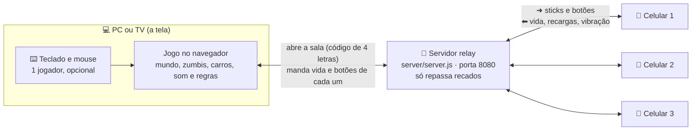

# Como o jogo funciona (sem código)

## A ideia em uma frase
O **PC** (ou a TV) roda o jogo inteiro. Os **celulares** são só controles: mandam para onde o jogador anda e que botão apertou.
Um **servidor pequeno** fica no meio, só passando recados entre a tela e os celulares.

## Quem conversa com quem

O que acontece quando alguém entra:
1. A tela abre o jogo e pede uma **sala** ao servidor. O servidor devolve um código de 4 letras (aparece no menu com o QR code).
2. O celular lê o QR code, abre a página de controle e manda o código. O servidor coloca o celular naquela sala.
3. A tela recebe "entrou alguém" e ocupa uma vaga no menu. **A vaga define a classe**: 1 Atirador, 2 Samurai, 3 Mago, 4 Bardo.
4. Durante a partida, cada celular manda os sticks ~30 vezes por segundo. A tela devolve vida, botões e recargas ~7 vezes por segundo.
5. O teclado do PC usa **exatamente o mesmo formato** do celular. Por isso dá para misturar teclado e celulares.

Por que assim: ninguém precisa instalar nada nem ter controle. E, como o jogo só roda na tela, todo mundo vê a mesma coisa.

## O que cada pasta faz

| Pasta / arquivo | O que faz | Exemplo do que você vê |
|---|---|---|
| `index.html`, `main.css` | A página do jogo e o visual do placar (HUD) | Relógio, pontos e vida no canto |
| `controller.html` | A página do controle no celular | Os dois sticks e os botões |
| `server/` | O servidor que passa recados entre tela e celulares | O código de 4 letras |
| `src/index.js` | Liga tudo e desenha a tela várias vezes por segundo | — |
| `src/game.js` | **As regras**: dano, morte, voltar em 25 s, suprimentos, fim de jogo | "FIM DE JOGO · sobreviveram 03:12" |
| `src/ui/` | O menu de 4 vagas e o placar | O menu inicial |
| `src/input/` | Teclado e mouse | WASD, clique, Q/F/G |
| `src/net/` | A conexão da tela com o servidor | "Servidor conectado" no menu |
| `src/controller/` | O código que roda no celular | Vibrar quando leva mordida |
| `src/camera/` | Câmera e tela dividida | A tela que divide quando o grupo se separa |
| `src/characters/` | As 4 classes, as habilidades, o corpo e as animações | Samurai dando a investida |
| `src/weapons/` | As armas do Atirador | Carabina, espingarda, pistola |
| `src/enemies/` | Os zumbis: o que veem, o que ouvem, como andam e atacam | Zumbi vindo atrás do barulho do tiro |
| `src/vehicles/` | Os carros: como andam, bancos, batidas | Dirigir a picape |
| `src/fx/` | Efeitos visuais e sangue | Explosão da granada, braço voando |
| `src/audio/` | Todo o som, criado na hora (não há arquivos de som) | Chuva, motor, gemido |
| `src/world/` | O mundo infinito: estradas, vilas, cidades, casas, placas, água, clima | Placa com nome de vila galega |
| `scripts/smoke.mjs` | Teste automático: abre o jogo sozinho e procura erros | — |
| `smoke/` | Fotos e anotações do último teste automático | As capturas no PR |
| `docs/` | Documentos para você | Este arquivo |

## Três ideias que explicam o resto

**Mundo em pedaços ("chunks").** O mapa é infinito, mas só os pedaços perto dos jogadores existem de verdade.
Quando você anda, pedaços novos aparecem na frente e os de trás somem. Com a tela dividida, cada jogador carrega menos pedaços, para não pesar.

**Mundo sempre igual.** Cada pedaço é calculado pela posição dele. Por isso a mesma estrada, as mesmas casas e os mesmos nomes
aparecem no mesmo lugar em toda partida. Hoje não existe "semente" para sortear outro mapa.

**Tudo é desenhado por código.** Não há arquivos de modelo 3D nem de som. Casas, zumbis, carros e sons são montados na hora.
Isso deixa o jogo leve para baixar, mas toda mudança visual passa por código.

## Como testar
- Depois de cada PR: siga `docs/TESTE-MANUAL.md` (5 minutos).
- A IA roda `npm run smoke` antes de abrir cada PR e põe as capturas na descrição.
